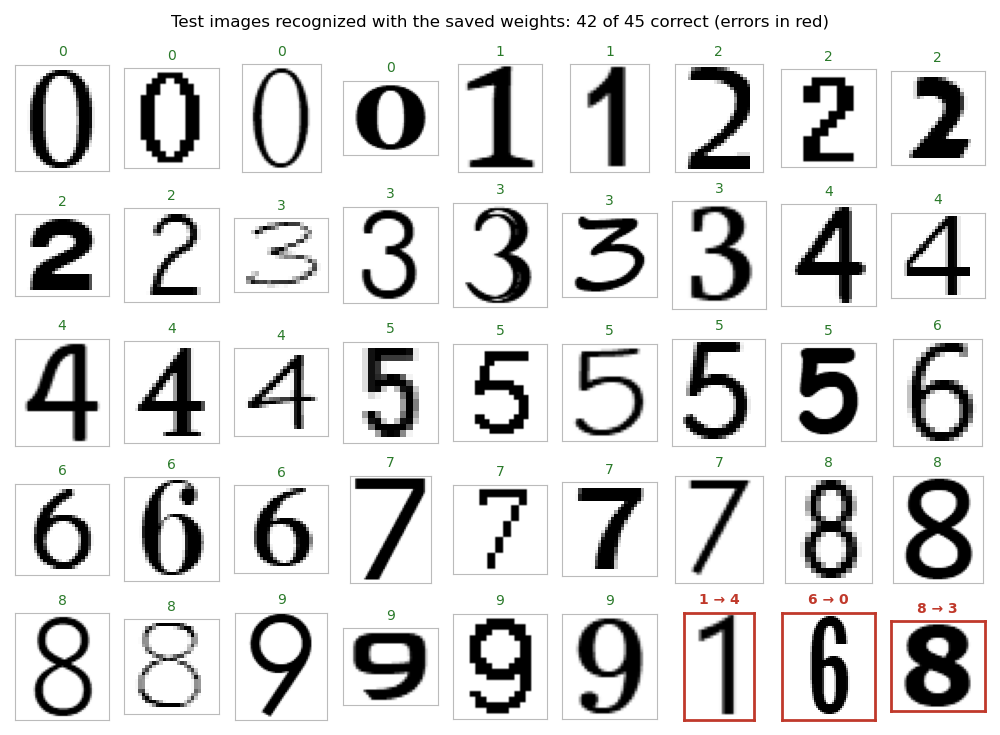
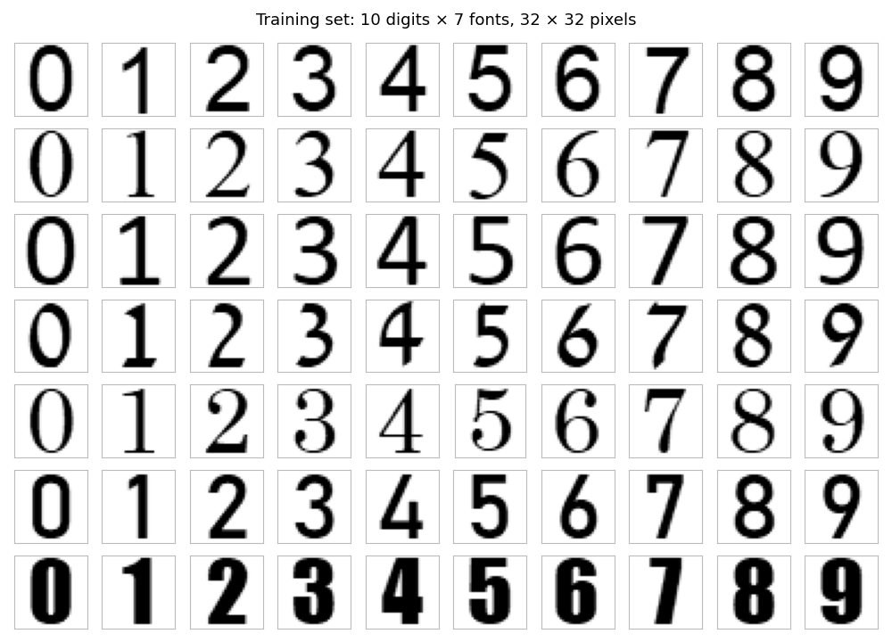
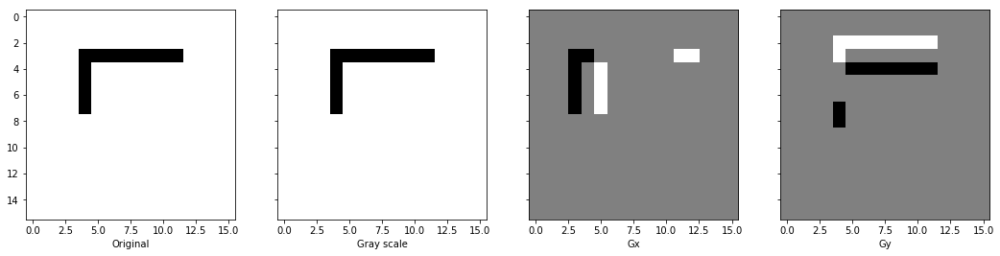
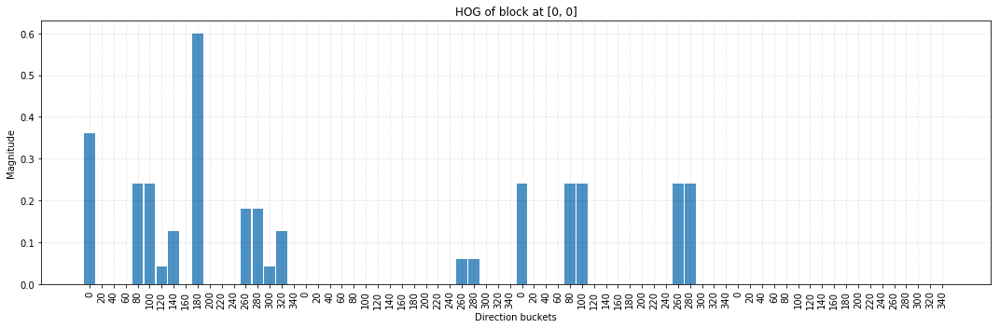

# Digits Recognition

[](https://github.com/IliaRakhlevski/Digits-Recognition/actions/workflows/ci.yml)

*M.Sc. course project · Intelligent Systems · Introduction to Intelligent Systems · [Afeka Tel Aviv Academic College of Engineering](https://www.afeka.ac.il/) · 2019*

Recognition of printed digits (0–9) with a Histogram of Oriented Gradients (HOG) and a neural network trained
by backpropagation. Both are implemented from scratch in C++; OpenCV is used only to read the image, convert
it to grayscale, resize it and filter it. A Python script shows how the HOG of an image is built.<br/>
**Language:** C++, Python 3. **Libraries:** OpenCV (C++); NumPy, SciPy, scikit-image, Matplotlib (Python).<br/>
**Build:** CMake. The original project report: [Course project.pdf](Course%20project.pdf).<br/>



---

## Algorithm

1. Load the image, convert it to grayscale and resize it to 32 × 32 pixels.
2. Find the edges: gradients G<sub>x</sub> and G<sub>y</sub> with the filters [-1 0 1] and [1 0 -1]<sup>T</sup>.
3. Divide the image into 16 cells of 8 × 8 pixels. For every cell build a histogram of the gradient
   directions with 18 buckets of 20° (0–360°); the magnitude of every pixel is split between the two nearest
   buckets.
4. Join the 16 histograms into one vector of 288 values and normalize it (L2 norm).
5. Classify the vector with a neural network: 288 inputs → 288 hidden neurons → 10 outputs, sigmoid
   activations. The recognized digit is the output with the largest value.

A histogram of gradient directions changes less than the raw pixels when the digit moves inside the image,
so the network gets more similar inputs for the same digit in different positions.

**Training.** Backpropagation, learning rate 0.01, random initial weights in [-0.5, 0.5]. An image that is
recognized incorrectly is trained until it is recognized correctly; the whole training set is repeated until
all its images are recognized correctly.

## Data

Digits drawn in Paint, BMP format.

* [training_images/](training_images): 70 images 32 × 32 — every digit in 7 fonts. Name: `<digit>_<font>.bmp`.
* [testing_images/](testing_images): 42 images of different sizes and fonts, not used for training, and
  [testing_images/failed/](testing_images/failed): 3 more test images that the saved weights recognize
  incorrectly. Name: `<digit>_<number>.bmp`.



## Results

| Weights | Accuracy on the 45 test images |
|---|---|
| Saved weights [weights.dat](weights.dat) (2019) | 93% (42 of 45) |
| Trained from random weights, 20 runs | 70% on average (56%–80%) |

Training on the 70 images takes 120–300 cycles (2–5 seconds). The result depends strongly on the random
initial weights: with only 7 examples of every digit the network learns the training fonts and generalizes to
new fonts only partly.

## Build and run

Requires CMake 3.16+, a C++17 compiler (for std::filesystem) and OpenCV 4 or newer.

```
cmake -S . -B build
cmake --build build --config Release
```

Run the program from the project directory: it reads `training_images/`, `testing_images/`, `digit.bmp` and
`weights.dat` from the current directory.

```
0 - Exit
1 - Load image          load digit.bmp
2 - Recognize           recognize the loaded image
3 - One image training  train the loaded image until it is recognized as the digit of item 4
4 - Digit to be trained the real digit of the loaded image
5 - Images set trainig  train on training_images/
6 - Save weights        save to weights.dat
7 - Load weights        load from weights.dat
8 - Test images set     recognize testing_images/, print the accuracy and the confusion matrix
9 - Test failed images  the same for testing_images/failed/
```

Example — test the saved weights: `7`, then `8`.

**HOG demonstration** ([hog.py](hog.py)): loads [figure.bmp](figure.bmp) (16 × 16 pixels — one block of
2 × 2 cells), shows the original, grayscale and edge images, and plots the histograms of the four cells.




## Project structure

```
Source.cpp          HOG, neural network, training and testing (C++)
hog.py              HOG demonstration (Python)
CMakeLists.txt      build
weights.dat         saved weights of the trained network
images/             figures for this README
training_images/    training set
testing_images/     test set
Course project.pdf  original project report
```
